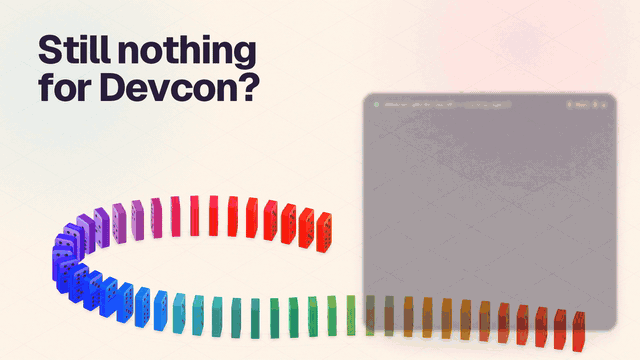

# Devcon booth selfie quest

A one-page phone app for an event booth. Visitors sign in, take a selfie with the Domino banner in the shot, and get 100 points once Domino checks the photo. A photo someone else already sent goes to booth staff and pays nothing.

A coding agent built and staged it from one prompt in 20 min 57 s, with nobody answering its questions. The prompt, with the brief and the design, is in [PROMPT.md](PROMPT.md). The agent's own record of the campaign and what it assumed is in [CAMPAIGN.md](CAMPAIGN.md).



The people in the clip are generated images, not real visitors. Domino's real photo check approved the first upload and sent the second to staff.

## Build your own

Paste this prompt into your coding agent:

```text
https://console.domino.run/docs/try-with-your-agent.txt
```

It sets up Domino, asks what you want to run, and builds a first version on a staging site you can open.

## How the photo check works

The quest is [`quests/booth-selfie.quest.ts`](quests/booth-selfie.quest.ts), adapted from Domino's `unique-photo` snippet. Each upload is checked on Domino's servers, in this order:

1. **Reuse.** `ctx.images.seen` compares the photo's perceptual hash with the photos other people already sent to this project. A distance of 8 or less counts as the same picture, so resized or re-encoded copies are caught; crops usually are not. A match goes to staff review with the reason "This photo matches an earlier submission by someone else." and pays nothing.
2. **The photo itself.** Otherwise `ctx.images.review` asks an AI model whether the photo shows "a selfie or photo taken at a conference booth, with a Domino banner or sign visible in the picture".
   - Pass: the attempt is accepted and the visitor gets 100 points, once per account.
   - Fail: rejected, and the visitor sees the model's reason and can try another photo.
   - Unclear: staff review.

Staff decide reviews in Domino Console, and the page updates by itself when they do. The criteria, the reuse threshold and the points are quest settings you can change in Console without a redeploy.
